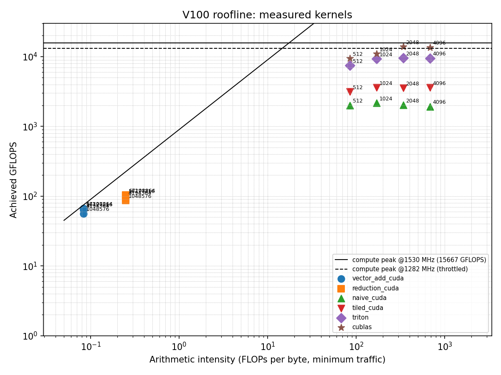

# GPU Energy and Perf/Watt Characterization (V100)

Measuring and modeling the energy cost of GPU kernels on an NVIDIA Tesla V100-SXM2-32GB: how much energy different kernels spend per FLOP and per byte moved, why, and how well simple models can predict GPU power for kernels they haven't seen.

Kernels measured: custom CUDA (vector add, parallel reduction, naive matmul, shared-memory tiled matmul), a Triton tiled matmul, and cuBLAS (`torch.matmul`). The tiled CUDA and Triton kernels come from [cuda-tiled-matmul-pytorch](https://github.com/Joshi-Shreyas/cuda-tiled-matmul-pytorch).

Run on Northeastern University's Explorer HPC cluster (SLURM).

## What's here

| File | Purpose |
|---|---|
| `power_measure.py` | Measurement harness: NVML hardware energy counter, idle baseline, 10 ms sampling of power, SM clock, temperature, and throttle reasons |
| `kernels_ext.cu` | Vector add, reduction, and naive matmul CUDA kernels as a PyTorch extension |
| `matmul_ext.cu`, `triton_matmul.py` | Tiled CUDA and Triton matmul kernels (from the matmul repo) |
| `collect_energy.py` | Runs every kernel at 4 sizes, checks correctness, saves `energy_results.csv` |
| `analyze_energy.py` | Computes GFLOPS, GB/s, watts, energy per FLOP/byte, GFLOP/J; draws `roofline.png` |
| `fit_energy.py`, `fit_dynamic.py` | Linear energy models separating compute and data-movement cost |
| `power_model.py` | Power prediction models, evaluated with leave-one-kernel-out testing |
| `energy_results.csv`, `metrics_results.csv` | Raw measurements and derived metrics from the runs below |

## Method

- **Energy** is read from NVML's cumulative hardware energy counter (more accurate than averaging sampled power). Energy per call = (counter after − counter before) / calls.
- **Each measurement loops a kernel for at least 3 seconds**, after warm-up, so the power sensor's internal averaging doesn't distort short kernels.
- **Idle power** is measured with a CUDA context open, at the start and end of the run. It drifted from 59.1 W to 65.4 W as the GPU warmed; "above idle" numbers interpolate between the two by run order. Choosing start vs. end idle changes dynamic power by up to 6.8%.
- **Every kernel is checked against a reference** (`torch.matmul`, `x + y`, `torch.sum`) before being measured.
- **Throttling** is detected from NVML throttle reasons (power cap, thermal, hardware slowdown). Clocks could not be locked (no admin rights on a shared cluster), so there are no DVFS experiments.

## Results (largest sizes: 64M elements / 4096×4096)

| Kernel | Time per call | Avg power | Energy per call | Achieved | % of roofline* | pJ per FLOP | GFLOP/J |
|---|---|---|---|---|---|---|---|
| Vector add | 1.008 ms | 172.9 W | 174 mJ | 799 GB/s | 88.8% | 2,598 | 0.38 |
| Reduction | 0.649 ms | 227.5 W | 148 mJ | 414 GB/s | 46.0% | 2,198 | 0.45 |
| Naive CUDA matmul | 71.33 ms | 287.0 W | 20.47 J | 1,927 GFLOPS | 12.3% | 148.9 | 6.71 |
| Tiled CUDA matmul | 38.16 ms | 292.2 W | 11.15 J | 3,602 GFLOPS | 24.1% | 81.1 | 12.33 |
| Triton matmul | 14.45 ms | 297.1 W | 4.29 J | 9,512 GFLOPS | 72.5% | 31.2 | 32.02 |
| cuBLAS | 10.12 ms | 295.1 W | 2.99 J | 13,576 GFLOPS | 94.5% | 21.7 | 46.01 |

\* Roofline uses minimum traffic (inputs read once, output written once) and a compute peak adjusted to each run's measured clock. Full results for all 24 runs are in `metrics_results.csv`.



## Key findings

1. **At the power cap, efficiency is set by speed.** All four matmul kernels drew about 287–297 W against a 300 W limit, so energy per call is essentially power × time. cuBLAS used about 1/7 of the naive kernel's energy for the same work, because it finished about 7x sooner, not because it drew less power.
2. **Fast kernels are power-limited.** cuBLAS and Triton hit the power cap from size 1024 up, and the GPU lowered their clocks (as low as 1282 MHz for Triton at 4096, vs. a 1530 MHz boost clock). The naive kernel never throttled.
3. **Memory-bound kernels cost about 120x more energy per FLOP** than cuBLAS (about 2,600 vs. 22 pJ/FLOP), because nearly all their energy goes to moving data.
4. **Streaming DRAM traffic costs about 140 pJ per byte above idle** (about 216 pJ total), measured directly from vector add, whose traffic is known exactly (no reuse possible).
5. **"Energy per byte" is not one constant.** The reduction reaches only about half of peak bandwidth yet draws more power than vector add, because its shared-memory tree and `__syncthreads()` add on-chip work.
6. **The naive kernel gets slightly worse at larger sizes,** consistent with the 6 MB L2 cache: at 512 its matrices fit in L2; from 1024 up they don't, and its energy per FLOP rises from 127 to 149 pJ.

## Energy model: separating compute and data movement

**First attempt (`fit_energy.py`): `energy = a·FLOPs + b·bytes + c·time`.** This failed in an informative way. Because power was nearly constant across runs (and pinned at the cap for matmuls), the time term absorbed almost everything (`c` ≈ 270 W instead of ≈ idle) and the byte coefficient came out negative. A bandwidth check also showed that traffic counts implied by each kernel's explicit reuse would require up to 8 TB/s for the naive kernel, far above the 900 GB/s DRAM limit, so most of that traffic was served by caches.

**Refined fit (`fit_dynamic.py`):** fit only dynamic energy (idle subtracted), with separate terms for DRAM bytes and on-chip bytes, on unthrottled runs (cuBLAS excluded, since its internal traffic is unknown):

| Term | Unthrottled runs (15) | All runs, no cuBLAS (20) |
|---|---|---|
| pJ per FLOP | 35.2 | 27.2 |
| pJ per DRAM byte | 166.4 | 167.6 |
| pJ per on-chip byte | 17.4 | 19.9 |
| Mean error | 28.7% | 29.9% |

All coefficients are positive and stable across subsets, and DRAM bytes come out roughly 8 to 10x as costly as on-chip bytes, the expected ordering. This ratio is a rough estimate: it comes from a fit on estimated byte counts with about 29% error. The errors are systematic (reduction under-predicted by about 55%, tiled CUDA by 34–48%), pointing to uncounted shared-memory traffic and synchronization.

## Power model: predicting unseen kernels

Target: average power per run. Evaluation: leave-one-kernel-out (train on 4 kernels, predict all sizes of the 5th). 20 runs, 5 kernels (cuBLAS excluded).

Two feature representations:
- **Activity rates:** FLOPs/s, DRAM bytes/s, on-chip bytes/s, shared-memory bytes/s, arithmetic intensity, tile size. Uses measured runtime, like a counter-based power model; never uses power or clock.
- **Static:** problem-size features only, no timing.

| Model | Activity rates: MAE | Activity rates: mean % error | Static: MAE | Static: mean % error |
|---|---|---|---|---|
| Mean baseline | 57.0 W | 26.1% | 57.0 W | 26.1% |
| Linear | 112.8 W | 41.5% | 49.3 W | 22.8% |
| Linear, capped at 300 W | **11.6 W** | **5.1%** | 48.9 W | 22.7% |
| Gradient boosting | 23.6 W | 10.4% | 30.2 W | 13.8% |
| MLP (16 units) | 397.9 W | 156.6% | 104.5 W | 47.3% |

- **A physics-informed model won:** linear in activity rates with predictions clipped at the power limit. Representation mattered more than model complexity.
- **Uncapped linear failed on one out-of-distribution kernel:** holding out the naive kernel (whose on-chip traffic rate far exceeds the others) made it predict hundreds of watts too high. For that kernel, the capped model's accuracy comes mostly from the clip itself.
- **Gradient boosting was robust but can't predict outside its training range** (it missed vector add, the lowest-power kernel, when it was held out).
- **The MLP overfit** with only 16 training runs per fold.
- **Timing information carries most of the signal:** without it, every model got substantially worse.

## Limitations

- **Small sample:** 24 runs across 6 kernels (20 runs / 5 kernels for the models). The held-out results show the method works; they don't prove it generalizes.
- **Byte counts are estimates.** Actual DRAM traffic wasn't measurable (Nsight Compute's hardware counters require admin permissions on this cluster). Traffic is bracketed between a minimum (inputs read once) and an algorithm-implied upper bound; Triton's shared-memory traffic in particular is a rough guess.
- **No DVFS experiments:** clocks couldn't be locked, so clock effects come only from the GPU's own power-cap throttling.
- **One GPU, one session.** Power numbers from other GPU models aren't comparable.
- **Power models take runtime as an input,** so they predict power given performance, not before running a kernel.

## Reproduce

Requirements: PyTorch with CUDA, Triton, the CUDA toolkit (`nvcc`), and:

```bash
pip install nvidia-ml-py numpy matplotlib scikit-learn
```

On a GPU node:

```bash
python power_measure.py      # sanity check: idle power, energy counter support
python collect_energy.py     # all measurements (a few minutes); writes energy_results.csv
```

Analysis (CPU only, works from the included CSVs):

```bash
python analyze_energy.py     # metrics_results.csv and roofline.png
python fit_energy.py         # first energy model
python fit_dynamic.py        # refined energy model
python power_model.py        # leave-one-kernel-out power models
```

If you re-run `collect_energy.py`, update `IDLE_START` and `IDLE_END` in `analyze_energy.py` and `fit_dynamic.py` with the idle values it prints.
